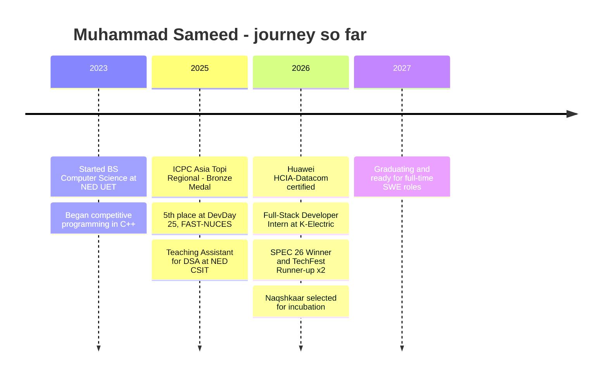

<!-- ================= HEADER ================= -->
<p align="center">
  
</p>

<p align="center">
  <a href="https://github.com/sameedrais">
    
  </a>
</p>

<p align="center">
  <a href="https://www.linkedin.com/in/sameedrais/"></a>
  <a href="mailto:sheikhsameed4@gmail.com"></a>
  <a href="https://leetcode.com/u/sameed-rais/"></a>
  <a href="https://codeforces.com/profile/Sameed-Rais"></a>
  
</p>

<!-- ================= QUICK HIGHLIGHTS ================= -->
<table align="center">
  <tr>
    <td align="center"><b>ICPC Asia Topi</b><br/><sub>Bronze Medal</sub></td>
    <td align="center"><b>Codeforces</b><br/><sub>Specialist</sub></td>
    <td align="center"><b>1,100+</b><br/><sub>Problems solved</sub></td>
    <td align="center"><b>3.88 / 4.0</b><br/><sub>CGPA · NED UET</sub></td>
    <td align="center"><b>HCIA-Datacom</b><br/><sub>Huawei · 900/1000</sub></td>
  </tr>
</table>

---

## About me

I'm **Muhammad Sameed** (you'll find me online as **Sameed Rais**), a final-year Computer Science student at **NED University of Engineering & Technology**, Karachi. I like understanding how things work under the hood and turning that into software that holds up in the real world.

My time goes into two things I care about: **building full-stack products**, most recently a security-advisory platform during my internship at **K-Electric**, and **competitive programming in C++**, where I won a **Bronze Medal at the ICPC Asia Topi Regional** and reached **Specialist on Codeforces**. Right now I'm building **Naqshkaar**, an AI system that designs real rooms with real, purchasable Pakistani products. The project was recently selected for incubation.

```cpp
#include <bits/stdc++.h>
using namespace std;

struct SoftwareEngineer {
    string name      = "Muhammad Sameed";                 // a.k.a. Sameed Rais
    string location  = "Karachi, Pakistan";
    string education = "BS Computer Science @ NED UET (2023 - 2027)";

    vector<string> builds = {"Full-stack web apps", "AI-powered products", "Smart contracts"};
    vector<string> solves = {"Codeforces", "LeetCode", "ICPC", "VJudge"};
    vector<string> stack  = {"C++", "Python", "TypeScript", "React", "Node.js", "PostgreSQL"};

    string currently = "Building Naqshkaar - AI-powered 3D interior design";
    string open_to   = "Software Engineering internships & graduate roles";
};

signed main() {
    SoftwareEngineer me;
    cout << "Hi, I'm " << me.name << ". Thanks for stopping by!" << "\n";
    return 0;
}
```

---

## Experience

### Full-Stack Developer Intern · K-Electric
`Jul 2026 – Aug 2026` · Karachi, Pakistan

Worked on **Advisory Tracker**, an internal web platform for tracking security advisories and managing patches across the organization.

- Built REST APIs with **Node.js / Express** and **PostgreSQL** (Knex.js), secured with JWT-based role-based access control
- Developed advisory filtering, inventory and team-management dashboards in **React**
- Automated email escalations with **Nodemailer** on the organization's Postfix mail server, and added Excel reporting

### Teaching Assistant, Data Structures & Algorithms · NED UET
`Aug 2025 – Dec 2025` · CSIT Department

- Ran tutorials on programming fundamentals, DSA and algorithmic problem solving for **100+ students**
- Mentored students on LeetCode / Codeforces problems, debugging, and time and space complexity

### Competitive Programming Community · NED UET
`2023 – Present`

- Manage VJudge groups and set weekly contests and practice sessions for NED students
- Helped coordinate CSIT students' participation in **IEEEXtreme 20.0**

---

## Featured projects

<table>
  <tr>
    <td width="50%" valign="top">
      <h3><a href="https://github.com/Naqshkaar">Naqshkaar</a></h3>
      <sub><b>Final Year Project · Selected for incubation · In development</b></sub>
      <p>An AI system for Pakistani homes. You describe your room, budget and style, and it builds a true-scale 3D design from <b>real, purchasable products</b> sold by local retailers. It checks walkways, door swings and furniture clearances, then gives an itemised cost in PKR with purchase links.</p>
      <p><code>Python</code> <code>FastAPI</code> <code>React</code> <code>Three.js</code> <code>PostgreSQL</code> <code>Image-to-3D</code></p>
    </td>
    <td width="50%" valign="top">
      <h3>Advisory Tracker</h3>
      <sub><b>K-Electric · Internal platform</b></sub>
      <p>Full-stack application for tracking security advisories and patch status, with role-based access, filtering, inventory and team dashboards, and automated email escalation through the company mail server.</p>
      <p><code>React</code> <code>Node.js</code> <code>Express</code> <code>PostgreSQL</code> <code>Knex.js</code> <code>JWT</code> <code>Nodemailer</code></p>
    </td>
  </tr>
  <tr>
    <td width="50%" valign="top">
      <h3><a href="https://github.com/sameedrais/ScholarshipDAO">ScholarshipDAO</a></h3>
      <sub><b>Blockchain · Deployed on Ethereum Sepolia</b></sub>
      <p>A decentralized scholarship platform built from four contracts: an ERC-20 governance token, ERC-721 NFT certificates, a treasury and a DAO controller. It supports snapshot voting with quorum checks and automatic ETH release, protected by reentrancy guards and pause controls.</p>
      <p><code>Solidity</code> <code>Hardhat</code> <code>OpenZeppelin</code> <code>React</code> <code>TypeScript</code> <code>Ethers.js</code></p>
    </td>
    <td width="50%" valign="top">
      <h3><a href="https://github.com/sameedrais/Diabetes-Prediction-Using-Random-Forest">Diabetes Prediction System</a></h3>
      <sub><b>Machine learning · Data structures</b></sub>
      <p>An ML-inspired prediction system covering the full pipeline: data handling, DSA-optimized processing in C++, and a web interface that visualizes the results.</p>
      <p><code>C++</code> <code>HTML</code> <code>CSS</code> <code>JavaScript</code></p>
    </td>
  </tr>
</table>

---

## Achievements

| | Result | Event |
|:-:|---|---|
| 🥇 | **Winner**, Speed Programming | SPEC '26 · NED UET |
| 🥈 | **Runner-up**, Speed Programming | TechFest 2026 · CSIT Department, NED UET |
| 🥈 | **Runner-up**, Koderz Kombat | TechFest 2026 · CSIT Department, NED UET |
| 🥉 | **Bronze Medal** with Team MuFaSa | ICPC Asia Topi Regional Contest (2025) |
| 🥉 | **Bronze Medal** | Ignite DPSPC |
| 🏅 | **5th Place**, representing NED | DevDay '25 · FAST-NUCES |

**Also:** Huawei Certified ICT Associate – Datacom (HCIA-Datacom), scored 900/1000 (Jun 2026) · 4.00 SGPA in Semester 5 · Naqshkaar selected for incubation (2026)

---

## Tech stack

<table>
  <tr>
    <td><b>Languages</b></td>
    <td></td>
  </tr>
  <tr>
    <td><b>Frontend</b></td>
    <td></td>
  </tr>
  <tr>
    <td><b>Backend &amp; Data</b></td>
    <td></td>
  </tr>
  <tr>
    <td><b>Tools</b></td>
    <td></td>
  </tr>
</table>

**Also worked with:** `Knex.js` `JWT` `Nodemailer` `Postfix` `Hardhat` `OpenZeppelin` `Ethers.js` `Hugging Face` `Google Colab` `pgAdmin` `DBeaver` `Assembly` `Prolog`

---

## Competitive programming

C++ is my language of choice for problem solving. I've solved **1,100+ problems** across LeetCode and Codeforces, compete in ICPC with **Team MuFaSa**, and help run practice contests for the NED CP community.

**Comfortable with:** dynamic programming · graphs (DFS, BFS, connected components) · number theory · binary search · two pointers and sliding window · prefix sums · Fenwick trees<br/>
**Currently sharpening:** segment trees with lazy propagation · harder DP

<p align="center">
  <a href="https://codeforces.com/profile/Sameed-Rais"></a>
  <a href="https://codeforces.com/profile/Sameed-Rais"></a>
  <a href="https://leetcode.com/u/sameed-rais/"></a>
</p>

<p align="center">
  <a href="https://codeforces.com/profile/Sameed-Rais"></a>
</p>

<p align="center">
  <a href="https://leetcode.com/u/sameed-rais/"></a>
</p>

---

## GitHub activity

<p align="center">
  
  
</p>

<p align="center">
  
</p>

<p align="center">
  <picture>
    <source media="(prefers-color-scheme: dark)" srcset="https://raw.githubusercontent.com/sameedrais/sameedrais/main/profile/snake-dark.svg" />
    <source media="(prefers-color-scheme: light)" srcset="https://raw.githubusercontent.com/sameedrais/sameedrais/main/profile/snake-light.svg" />
    
  </picture>
</p>

---

## My journey so far



---

## Right now

- Building **Naqshkaar** as my final year project and an incubated product
- Sharpening segment trees, lazy propagation and harder dynamic programming
- Learning **Mandarin Chinese** (HSK) on the side
- Looking for **Software Engineering internships and graduate roles** (graduating 2027)

<p align="center">
  <b>Happy to talk about engineering roles, competitive programming or Naqshkaar.</b><br/>
  Reach me at <a href="mailto:sheikhsameed4@gmail.com">sheikhsameed4@gmail.com</a> or on <a href="https://www.linkedin.com/in/sameedrais/">LinkedIn</a>.
</p>

<p align="center">
  
</p>
